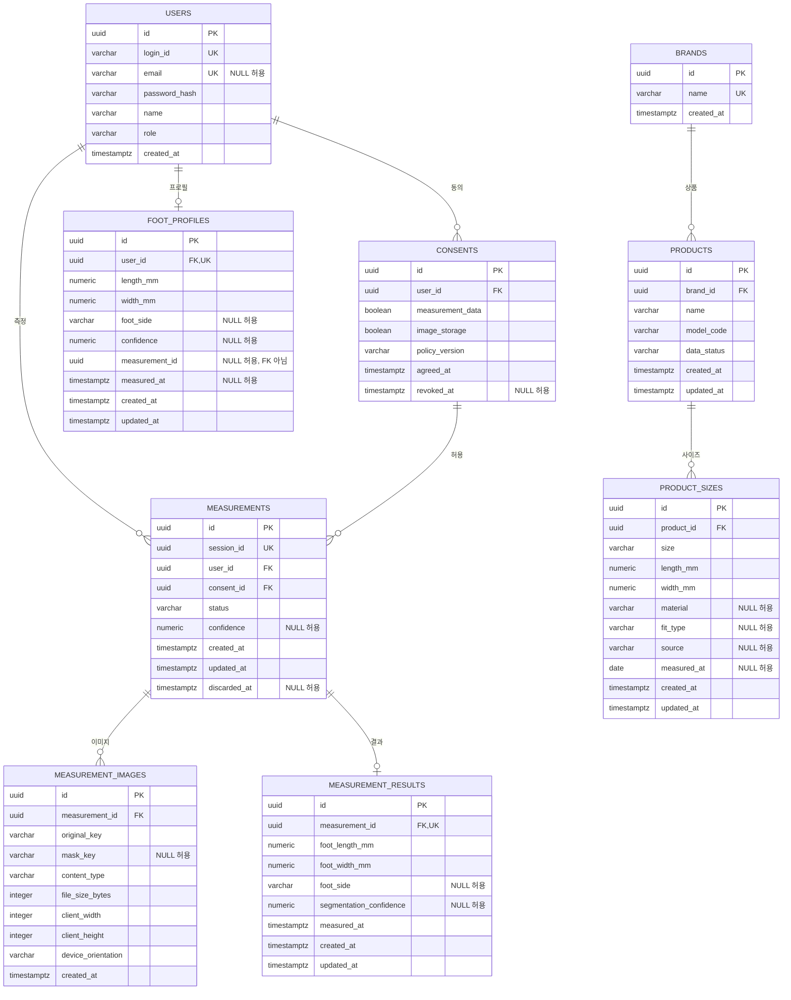

# 데이터베이스 ERD

2026년 11월 21일 기준 SQLAlchemy 모델과 AWS에 배포된 PostgreSQL의 실제
스키마를 대조해 작성했습니다. 아래 ERD에는 데이터베이스 외래키로 강제되는
관계만 표시했습니다.

- `PK`: 기본키
- `FK`: 외래키
- `UK`: 유일키

## 관계 및 삭제 규칙

| 부모 테이블 | 자식 테이블 | 관계 | 삭제 규칙 |
|---|---|---|---|
| `users` | `consents` | 1:N | 사용자 삭제 시 함께 삭제 |
| `users` | `measurements` | 1:N | 사용자 삭제 시 함께 삭제 |
| `users` | `foot_profiles` | 1:0..1 | 사용자 삭제 시 함께 삭제 |
| `consents` | `measurements` | 1:N | 참조 중인 동의 정보는 삭제 제한 |
| `measurements` | `measurement_images` | 1:N | 측정 삭제 시 함께 삭제 |
| `measurements` | `measurement_results` | 1:0..1 | 측정 삭제 시 함께 삭제 |
| `brands` | `products` | 1:N | 브랜드 삭제 시 함께 삭제 |
| `products` | `product_sizes` | 1:N | 상품 삭제 시 함께 삭제 |

`products`는 `(brand_id, model_code)` 조합이 유일하고, `product_sizes`는
`(product_id, size)` 조합이 유일합니다.

## 확인된 구조상 주의점

- `foot_profiles.measurement_id`는 측정 ID를 저장하지만 외래키가 아닙니다.
  따라서 존재하지 않거나 삭제된 측정 ID가 저장되는 것을 PostgreSQL이
  차단하지 못합니다.
- 애플리케이션은 SQLAlchemy의 `create_all`로 테이블을 초기화하며 Alembic
  마이그레이션 이력이 없습니다. `create_all`은 기존 컬럼이나 제약조건의
  변경을 안전하게 반영하지 못하므로 스키마 변경 전에 마이그레이션 도입이
  필요합니다.
- 상태와 사용자 역할은 데이터베이스 체크 제약조건이 없는 문자열입니다.
  허용값은 애플리케이션 코드에서만 검증합니다.
- 현재 스키마에는 위시리스트, 장바구니, 주문, 결제, 재고 테이블이 없습니다.
- 확인 당시 배포 DB에는 사용자 2명만 존재하며 나머지 8개 테이블은
  비어 있었습니다.
